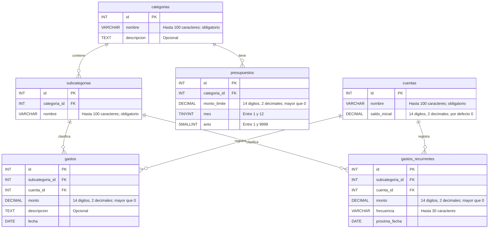

# Estructura de la base de datos: Mis gastos

**Estudiantes:**

- Nestor Alejandro Mamani Condori
- Ariel Alvarez Mamani

La base de datos `dbgastos` organiza las categorías, cuentas, gastos y presupuestos de la aplicación. El siguiente diagrama muestra las seis tablas del dominio y sus relaciones.

## Relaciones y reglas

- Una categoría puede tener varias subcategorías y varios presupuestos. Cada subcategoría y cada presupuesto pertenecen a una sola categoría.
- Una subcategoría y una cuenta pueden estar asociadas a varios gastos y gastos recurrentes. Cada gasto pertenece a una subcategoría y a una cuenta.
- Los identificadores son claves primarias autoincrementales y las claves foráneas conectan las tablas. Los campos son obligatorios salvo las descripciones indicadas como opcionales.
- Solo puede existir un presupuesto por categoría, mes y año. Los montos de gastos, gastos recurrentes y presupuestos deben ser mayores que cero.

El diagrama se basa en `sql/dbgastos.sql`. Flask-AppBuilder también crea tablas propias para la seguridad y la gestión de usuarios, que no se muestran aquí.
